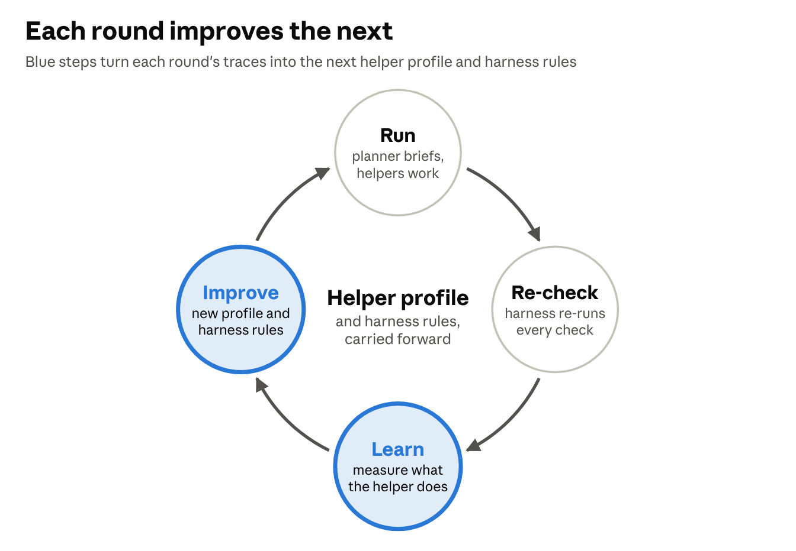
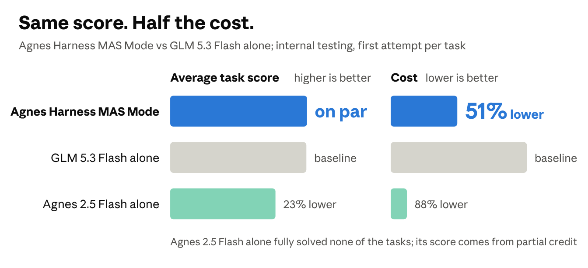
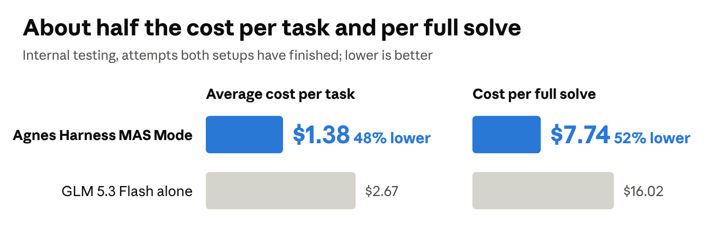
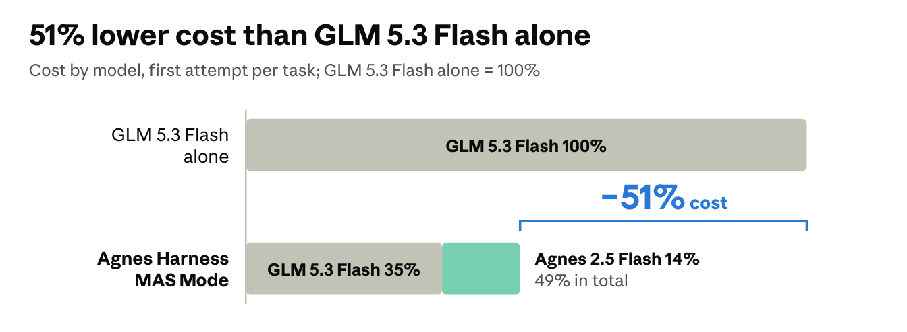
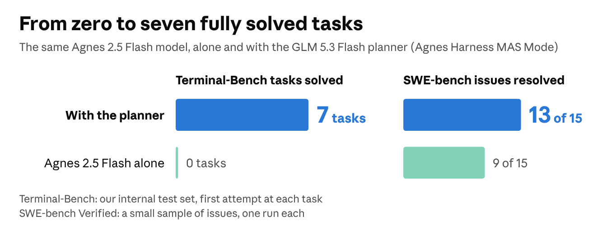

# Agnes Harness MAS Mode: Recursive Self-Improvement for Multi-Agent Systems

Sep 29, 2026 · @Aiden

A multi-agent system that learns from its own traces how its helpers behave, and improves its harness from what it learns. Early results from internal testing on terminal tasks.

Agnes Harness MAS Mode is a multi-agent system built around a recursive self-improvement (RSI) loop. A planner model, GLM 5.3 Flash, delegates jobs to a lower-cost helper model, Agnes 2.5 Flash, through the Agnes harness, which runs both models and enforces the rules of delegation. After every round of work, the system's own traces become two kinds of improvement: a sharper profile of what the helper can and cannot do, which the planner reads before it delegates, and new rules that the harness enforces. The next round runs on the improved system. So far, an AI coding agent carries out the learning steps between rounds, with each change reviewed; the next stage hands them to the planner itself.

In internal testing on terminal tasks from Terminal-Bench 4.0, Agnes Harness MAS Mode matched GLM 5.3 Flash working alone on task accuracy at about half the cost, under the same token budget. Across rounds of the RSI loop, work moved from the planner to the helper: the helper's share of tokens rose from a third to 60%, and the planner used about a fifth fewer tokens than in the first round.

## Highlights

- The same accuracy at about half the cost. Agnes Harness MAS Mode matched GLM 5.3 Flash alone on average task score, at 48% lower cost.

- The expensive model does less than half the work. Inside Agnes Harness MAS Mode, GLM 5.3 Flash used 68% fewer tokens than when it works alone, and the helper did most of the reading and writing.

- The largest savings are on the longest tasks. Where GLM 5.3 Flash alone ran out of its token budget, Agnes Harness MAS Mode cost 59% less.

- The loop corrects itself. When one round's profile led the planner to over-delegate, the traces showed it, and the next round fixed it with a harness rule.

- The harness learns what prompts cannot teach. Four behaviors that prompt instructions failed to change were fixed by rules learned from the traces and enforced by the harness.

- From zero to seven. On its own, Agnes 2.5 Flash fully solved none of our Terminal-Bench tasks; with the planner, seven. On SWE-bench Verified issues, it resolved 44% more with the planner.

## Why a multi-agent system needs an RSI loop

A planner can only delegate well to a helper it understands. In our experiments, a stronger helper barely moved the score, while the planner's decisions set the ceiling. Under the same planner, a larger helper left the score unchanged on four of the five tasks we tested. Giving the helper's job to GLM 5.3 Flash itself changed nothing on the task we tested; the same hidden tests failed either way.

The component worth improving is therefore not the helper but the planner's knowledge of it, together with the harness rules around both. Both can be learned from the traces the system already produces.

The helper rewards that knowledge. Working alone, Agnes 2.5 Flash tends to stop at the first answer that looks right and to report "done" early. As a helper, its work passed the planner's checks in 77% of jobs that carried one or two checks written in advance.

## The RSI loop

Each round of the loop improves the system that runs the next round. A round has four steps.

The RSI loop · four steps per round

- Run. The planner writes briefs, each a job plus one or more checks the result must pass, and hands them to helpers. The harness refuses any brief that breaks its rules.

- Re-check. When a helper reports, the harness re-runs the brief's checks itself, so every job leaves a re-checked record rather than the helper's own word.

- Learn. The traces are measured: which kinds of job pass, at what size, with how many checks, and which habits recur.

- Improve. What was learned becomes a new helper profile, which the planner reads before it delegates, and new rules, which the harness enforces.

The profile works like a new manager's notes on a new hire: what they do well, what they do poorly, and how much instruction they need. The harness rules are the part of that knowledge that must hold every time, so they are enforced rather than advised.

In the rounds so far, the Learn and Improve steps ran between rounds: scripts measured the helper jobs, an AI coding agent drafted the new profile and rules, and each change was reviewed before it went in. The next stage hands these steps to the planner itself.

## Results: the same accuracy at about half the cost

In our internal testing on Terminal-Bench 4.0 tasks, Agnes Harness MAS Mode matched GLM 5.3 Flash alone on accuracy and cost about half as much. We measure accuracy as the average task score: the share of a task's hidden tests passed, averaged over attempts so that a task with many tests does not outweigh one with few. The baseline is GLM 5.3 Flash working in Terminus 2, the benchmark's reference agent, under the same time and token limits.

|  | Agnes Harness MAS Mode, against GLM 5.3 Flash alone |
| --- | --- |
| Average task score | On par |
| Full solves (full marks from the grader) | On par |
| Attempts where it scored higher or lower | Higher on 36%, lower on 23%, level on the rest |
| Planner tokens (first attempt at each task) | 68% fewer |

First attempt at each task, the only attempt Agnes 2.5 Flash alone made · over all attempts, cost is 48% lower (chart below)

Agnes 2.5 Flash alone is the cheapest setup, but it fully solved none of the tasks; even with partial credit, its average task score is 23% lower than GLM 5.3 Flash alone. With the planner, Agnes Harness MAS Mode matches GLM 5.3 Flash alone on average task score at about half its cost.

Because the two setups reach the same accuracy, the saving holds both per task and per fully solved task.

Attempts both setups have finished · GLM 5.3 Flash at $0.15 / $0.50 and Agnes 2.5 Flash at our self-hosted $0.05 / $0.15 per million input / output tokens

The largest savings come on the longest tasks. Where GLM 5.3 Flash alone ran out of its 40M-token budget, which our evaluation counts as a failure, Agnes Harness MAS Mode cost 59% less and stayed within the budget in all but one case.

The savings come from moving work to the helper, whose tokens cost 67% to 70% less. Inside Agnes Harness MAS Mode, the planner uses 68% fewer tokens than when it works alone, so spending on GLM 5.3 Flash falls by 65%, and the helper adds only 14% of what GLM 5.3 Flash alone costs.

First attempt at each task · same prices as above

The planner also lifts its helper. On its own, Agnes 2.5 Flash fully solved none of our Terminal-Bench tasks; paired with the planner in Agnes Harness MAS Mode, it fully solved seven on the first attempt. On a small sample of SWE-bench Verified issues, it resolved 44% more with the planner than working alone.

Terminal-Bench: first attempt at each task · SWE-bench Verified: a small sample, one run each

## What the loop learned

### Describing the helper as stronger made the planner worse, and the loop caught it

The first profile was built from measurements of an older, weaker helper. For round 1, the loop measured Agnes 2.5 Flash on its helper jobs and rewrote the profile to describe it as more capable. The planner responded by delegating much larger jobs: listed steps per brief quadrupled.

The larger jobs failed more often. The share of jobs that passed every check on re-check fell from 69% to 50%, the planner stepped in more, and the round used 27% more planner tokens for a lower average task score.

The traces showed the cause, and round 2 fixed it with a harness rule rather than more profile text: the harness now limits how often, and for how long, the planner may take over a job. Round 3 repeated round 2 to confirm the result. Rounds 2 and 3 moved the work to the helper, whose share of tokens rose from a third to 60%. The planner used about a fifth fewer tokens than in round 0, and the average task score returned to its starting level or slightly above. In every round, Agnes Harness MAS Mode scored well above Agnes 2.5 Flash working alone on the same tasks: 47% higher in its weakest round and 65% higher by round 3. The chart also marks targets for rounds 4 and 5, which have not been run: planner tokens 30% below round 0 and a 70% helper share.

↗ RSI loop rounds 0 to 3 measured, rounds 4 and 5 targets · same task set each round

A profile changes the behavior it describes. That is why every change the loop makes has to be tested on fresh work before it is kept.

### A helper that thinks longer did not pay off

We also tested turning on the helper's reasoning mode ("thinking"), so that Agnes 2.5 Flash reasons at length before it acts. With thinking off, as in the standard setup, the system scored 7% higher and spent 7% less on the planner, so the change was not kept. The planner's brief does the thinking the job needs.

↗ Same internal test tasks, one run each · a run stopped at the token limit scores zero

### What the traces taught the planner about its helper

↗ Agnes 2.5 Flash helper jobs from earlier runs, each re-checked by the harness

| What the traces showed | What the profile now tells the planner |
| --- | --- |
| Jobs with one or two checks passed their re-check most often | Give each job one or two checks that compute the right answer |
| Reading and fixing jobs pass most often; verifying jobs least | Delegate reading, reporting and named fixes |
| About 12% of "done" reports failed their re-check | Trust the re-check, not the report |
| Left to choose, the helper sometimes swaps in an easier method | Name the method in the brief |
| A verifying job whose script tested nothing still passed its re-check | Write the final, whole-task check yourself |

## The harness improves too

When the traces show a behavior that prompt instructions fail to change, the loop turns the fix into a rule the harness enforces. Four such rules came from trace reviews in our earlier experiments, and each worked where the instruction had not. A fifth, the limit on take-overs, came from round 2 of the loop.

| What the prompt said | What the traces showed | Rule the harness now enforces | Effect |
| --- | --- | --- | --- |
| Stop after three attempts at the same fix | One helper rewrote one file over 100 times | A note at 10 rewrites and a forced report at 20 | Runaway loops end |
| Checks must compute the expected answer | Most checks only re-ran the helper's own script | A brief without an independent check is refused | Every job that runs carries an independent check |
| Stop at about 60 calls | 16% of helpers ran past 100 calls and used 58% of helper tokens | Helpers report at 60 calls | Helper tokens fell 60%, with the score about the same |
| Helpers cost a fifth of what you do | The planner delegated at 7% of its chances | The planner's terminal stays closed until a helper reports | The planner delegated at 95% of its chances |

↗ Earlier experiments on curated tasks · before and after each harness rule

The lesson for the loop is that learning must reach the harness as well as the prompt. A profile can advise; only the harness can enforce.
